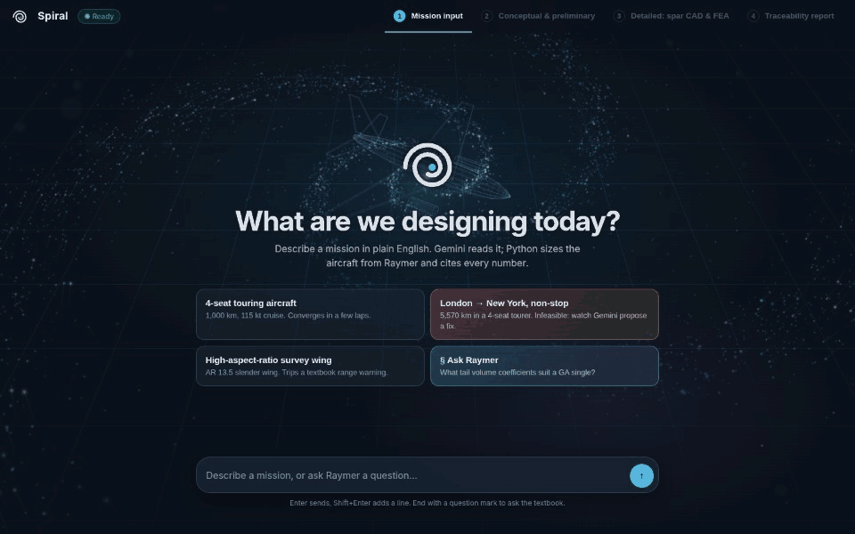
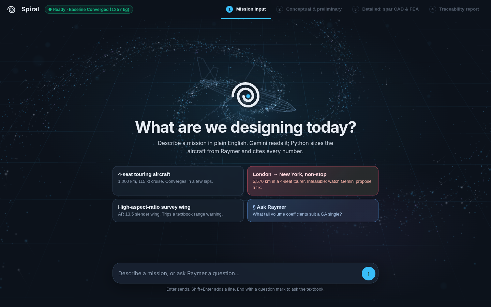
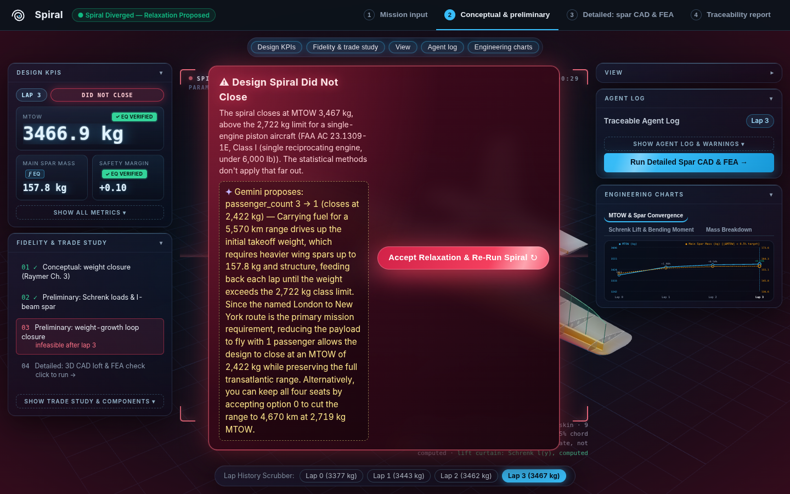
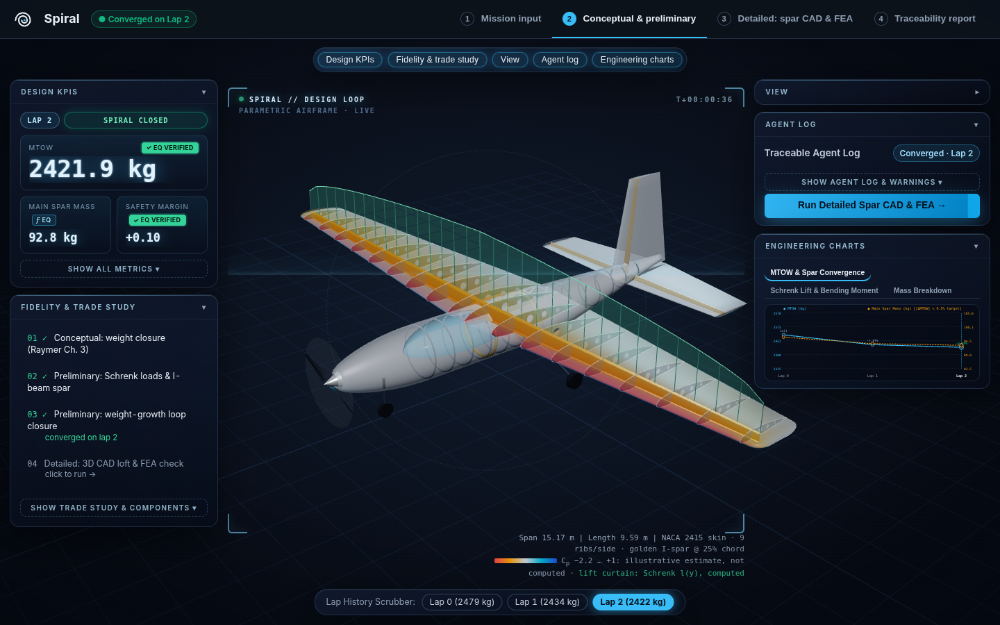
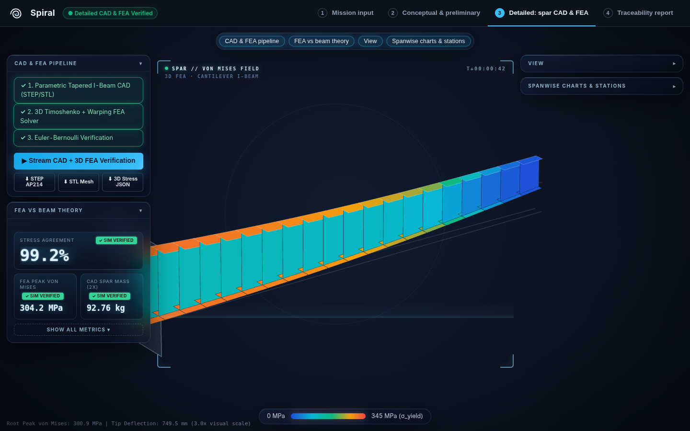
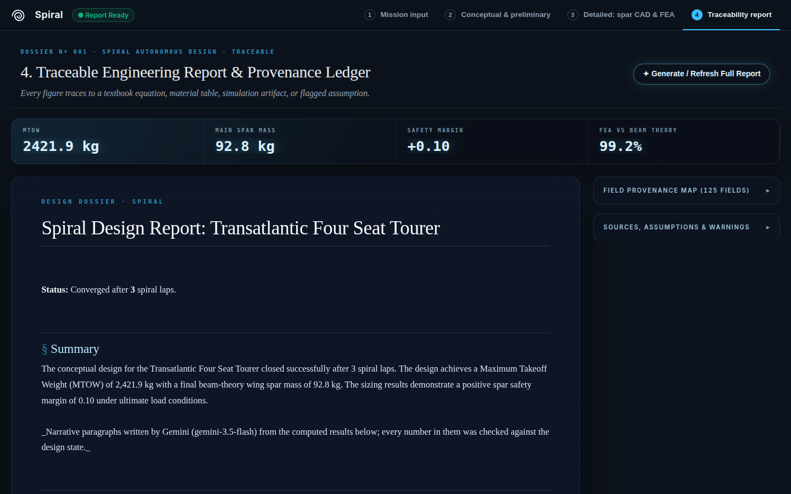
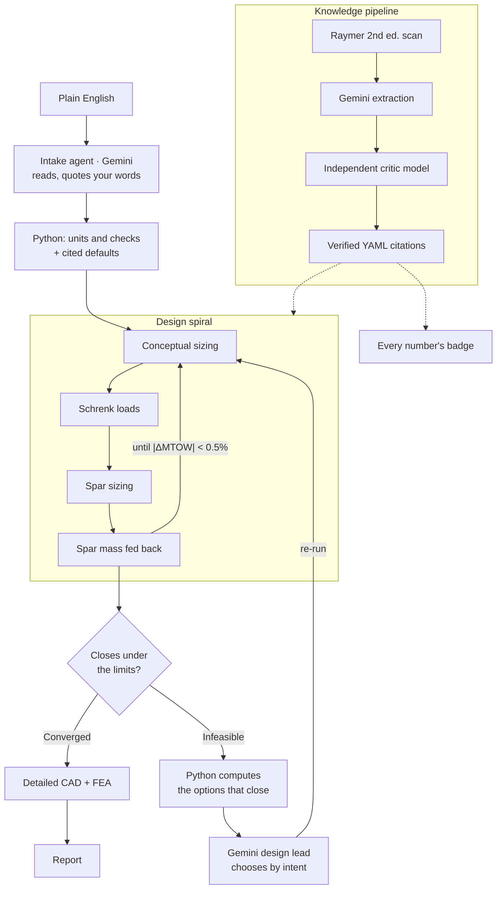

<p align="center"></p>

# Spiral

**Describe an aircraft in plain English. Spiral sizes it, closes the design spiral, and shows where every number came from.**

*Halloween at Imperial: Gemini Edition.*

An agent turns your description into a structured spec. It then runs the conceptual and preliminary design spiral until MTOW converges: weight closure, then Schrenk spar loads, then I-beam spar sizing, then the spar mass goes back into the weight closure. Finally it carries the main wing spar to CAD and FEA. If the design can't close, Python finds the single-field changes that would close it, and Gemini, as design lead, picks one by what you asked for. Every number traces to an equation, a table row in the textbook, a simulation, or a flagged assumption.

The core rule: **Gemini decides and writes; Python computes.** Gemini never supplies a number.

| **391 pages** | **692 · 118 · 886** | **596** | **~100** | **within ~10%** |
|:---:|:---:|:---:|:---:|:---:|
| of Raymer 2nd ed., read as page images by Gemini | equations · tables · rules of thumb extracted | equations confirmed by an independent critic model | numbers in every run, each with its source | of a real Cessna 172S for the default tourer: MTOW, wing area, span, power |

## See it run

<p align="center"></p>

<table>
<tr>
<td width="33%" valign="top"><br><sub><b>1.</b> Describe the aircraft</sub></td>
<td width="33%" valign="top"><br><sub><b>2.</b> Intake: your words, Gemini inferred, cited defaults</sub></td>
<td width="33%" valign="top"><br><sub><b>3.</b> Over the class limit: the design lead proposes a fix</sub></td>
</tr>
<tr>
<td width="33%" valign="top"><br><sub><b>4.</b> The spiral converges</sub></td>
<td width="33%" valign="top"><br><sub><b>5.</b> Main wing spar: CAD and FEA</sub></td>
<td width="33%" valign="top"><br><sub><b>6.</b> Report, with the textbook items behind the numbers</sub></td>
</tr>
</table>

## Run it

```bash
python3.12 -m venv .venv && .venv/bin/pip install -r requirements.txt && cp .env.example .env   # add your GEMINI_API_KEY to .env
.venv/bin/uvicorn server.app:app   # then open http://localhost:8000
```

No key? Open `web/index.html?demo` through any static server to replay recorded runs (for example `python3 -m http.server 8080`, then http://localhost:8080/web/index.html?demo), or set `SPIRAL_OFFLINE=1` to run the full app on its deterministic fallbacks. Full setup is under [Setup](#setup).

## How it works

<p align="center"></p>



The full architecture and the frozen contract are in [DESIGN_SPEC.md](DESIGN_SPEC.md).

## How Gemini is used

The default model is `gemini-3.5-flash` (set with `GEMINI_MODEL`). Intake, the infeasibility explanation and the report each have a deterministic offline fallback. It runs when `SPIRAL_OFFLINE=1` is set, when there is no API key, or when a call fails, so the app and the tests work without Gemini.

| Stage | What Gemini does | What Python does |
|---|---|---|
| Intake (`spiral/agent/gemini.py`) | Reports each requirement with the value and unit as written and the user's exact words. It may only *infer* crew, passengers and limit load factor. | Converts units and applies range checks. A quote that isn't in the description is treated as inferred, so the value is dropped unless it is one of the three inferable fields. Python fills every unstated field with a cited default and records the reason in `defaulted_fields`. |
| Infeasibility (design lead) | **Decides** which of the verified options to propose, from the user's own description, and explains it. A named route ("London to New York non-stop") keeps the range and gives up seats; a stated purpose of carrying people ("family tourer") keeps the seats and gives up range. | Computes every single-field change that closes the spiral by re-running it: the longest range (bisection) and the most passengers. It checks every number in Gemini's text against a digest of the run; a rejected answer gets one retry, then a deterministic choice (the smallest change) and explanation. |
| Report narrative | Writes the summary and discussion paragraphs. | Writes every table and figure. A validator rejects any number that isn't in the design state. A rejected answer gets one retry; after that the report keeps the computed sections only. |
| Knowledge extraction (`scripts/extract_knowledge.py`) | `gemini-3.5-flash` reads the scanned pages themselves, as two-page PDF chunks rather than OCR text. An independent critic, `gemini-3.1-pro-preview`, checks every extracted item against the same pages. | Merges the extraction and the critique, and sets `verified` flags on the curated YAML rows (see [Traceability](#traceability)). |

## Engineering methods

All methods come from Raymer, *Aircraft Design: A Conceptual Approach*, 2nd ed. (AIAA, 1992). Each constant is a row in `knowledge/tables/*.yaml` or `knowledge/equations.yaml`, and each row carries its citation.

| Step | Method | Source (Raymer 2ed) |
|---|---|---|
| Weight closure | W0 = W_payload / (1 − Wf/W0 − We/W0), solved by bisection | Eq. 3.4; empty-weight regression from Table 3.1 |
| Fuel fraction | Warm-up/take-off, climb and landing segment fractions | Table 3.2 |
| | Breguet cruise and loiter, with loiter at 0.866 L/D max | Eqs. 3.6, 3.8, 3.10; p. 22 |
| | 6% reserve and trapped fuel | Eq. 3.11 |
| | Propeller SFC and efficiency, cruise vs loiter | Table 3.4 |
| Wing | Wing loading from stall speed at sea level | Eq. 5.6 |
| Power | The larger of the statistical hp/weight (Table 5.2) and the cruise requirement | Table 5.2; Eq. 5.2 |
| Spar loads | Schrenk lift at ultimate load, integrated tip to root for shear and bending | Fig. 14.10 |
| Spar sizing | Caps carry the bending (Eq. 14.35) and are sized at ultimate load (n = 3.8 × 1.5 = 5.7) to compression yield F_cy. The web must neither fail in shear (F_su) nor buckle (Eq. 14.37, K = 4.8). Minimum gauges apply. Tip deflection comes from Euler-Bernoulli double integration. | Eqs. 14.35–14.37 |
| Materials | 2024 (default) and 7075 aluminium | Table 14.3 |

**Feedback and convergence.** On lap 0 the spar is a fixed share of the statistical empty weight; this share is a flagged assumption. From lap 1 on, the computed spar mass replaces that share. The spiral has converged when |ΔMTOW| < 0.5% between laps.

**Infeasible** when any of these happens:
- the fuel fraction reaches 0.42;
- MTOW grows by more than 2% for 4 consecutive laps;
- the spiral converges above the single-engine piston class limit of 2,722 kg (6,000 lb). The citation, FAA AC 23.1309-1E Class I, is flagged unverified;
- the weight closure has no root;
- 12 laps pass without convergence.

When the design is infeasible, Python computes every single-field change that makes it close, each verified by re-running the full spiral: the longest range (bisection, to 10 km) and the largest passenger count. Gemini chooses between these options by the user's stated intent and explains the trade-off, naming the other option. It never supplies the numbers.

## Traceability

- Every one of the ~100 numeric fields in `DesignState` has an entry in `DesignState.provenance`: a kind (equation, table, simulation, assumption, user input or Gemini-inferred), a source, and a `verified` flag. Hovering a number in the UI shows its source.
- On intake, stated values keep the user's exact words (`MissionSpec.stated_fields`, e.g. `"cruise 115 kt"`), which Screen 1 shows under each field. Unstated values are Python's cited defaults ("Default: Assumed 7.6, ... (Raymer 2ed, Table 4.1 (p. 51))"), never Gemini's. Only crew, passengers and load factor can be marked "Gemini inferred".
- The agent log names who did each step: intake agent (Gemini), layout (Python, cited tables), sizing & structures (Python), convergence check (Python), design lead (Gemini), detailed design (CAD + FEA).
- The report ends with **Textbook items behind the numbers**: each Raymer citation the run used, the equation or table row as extracted from the scanned page, and the critic model's verdict. It is built from the local knowledge base, and left out of committed fixtures so no book content enters the repo.
- `scripts/extract_knowledge.py check --write` sets `verified: true` on a YAML row in `knowledge/` only when the critic confirmed that exact book item (same table, equation or figure number) and every number in the row appears in it. Otherwise it sets `false`.
- Two kinds of value stay unverified on purpose: values read from charts (L/D max = 11 from Fig. 3.6, t/c = 0.15 from Fig. 4.14), and our own derivations (for example the two-cap sizing formula and the lap-0 spar share).

## Knowledge pipeline

The knowledge base was built from the Raymer 2ed scan: 391 PDF pages in 196 chunks.

| Kind | Extracted | Confirmed by critic | Disputed by critic |
|---|---|---|---|
| Equations | 692 | 596 | 96 |
| Tables | 118 | 91 | 27 |
| Rules of thumb | 886 | | |
| Figures | 445 | | |

The critic also listed 152 items the extractor missed.

The stages are `extract` (about 8 min), `critique` (about 11 min), `merge`, then `check --write`. `extract` and `critique` are resumable: chunks already done are skipped. The output goes to `knowledge/extracted/`, which is gitignored, and so are the PDFs in `books/` (copyright). Never commit them. Only the curated YAML rows with their citations are committed.

## Setup

```bash
python3.12 -m venv .venv && source .venv/bin/activate   # 3.12: CadQuery has no 3.14 wheels
pip install -r requirements.txt
cp .env.example .env    # set GEMINI_API_KEY; GEMINI_MODEL=gemini-3.5-flash
python -m pytest -q     # also: python -m unittest discover -s tests
uvicorn server.app:app --port 8000   # UI + API on http://localhost:8000
python scripts/generate_fixtures.py  # regenerate fixtures/ (offline by default)
```

To run without Gemini, set `SPIRAL_OFFLINE=1`. The tests need the packages from `requirements.txt` (PyYAML at least).

**Rebuilding the knowledge base.** This needs the PDF and an API key.

1. Put the PDF in `books/`. The default path is `books/Aircraft design : a conceptual approach.pdf`; for another file, pass `--pdf`.
2. Run the four stages:

```bash
python scripts/extract_knowledge.py extract     # add --pages 14-17 to limit the range
python scripts/extract_knowledge.py critique
python scripts/extract_knowledge.py merge
python scripts/extract_knowledge.py check --write
```

## API

The endpoints are in `server/app.py`, and the payload types are the dataclasses in `spiral/contract.py`. `fixtures/` holds a real example of every payload, so the frontend can be built with no backend running.

| Endpoint | Request | Response |
|---|---|---|
| `POST /api/intake` | `{description}` | `{spec, sources, assumptions, warnings}` |
| `POST /api/spiral/run-sync` | `{spec}` | `DesignState` |
| `POST /api/spiral/stream` | `{spec}` | SSE stream: `log` and `lap` events, then exactly one of `converged`, `infeasible` or `error` |
| `POST /api/components/spar` | `{state}` | `DesignState` with `components.main_wing_spar` filled |
| `POST /api/components/spar/stream` | `{state}` | SSE stream: `component_step` events and a `log`, then `component_done` or `error` |
| `POST /api/report` | `{state}` | `{report_markdown, state}` |
| `GET /artifacts/{filename}` | | STEP, STL and stress-mesh files |

SSE event types (`SSE_EVENTS`):

| Event | Payload |
|---|---|
| `lap` | `lap_record`, `sizing`, `loads`, `spar`, `geometry` |
| `log` | `entry` (lap, stage, message, citations, level, timestamp) |
| `converged` | `state` |
| `infeasible` | `reason`, `proposed_relaxation`, `state` |
| `component_step` | `component_id`, `step` (`cad`/`fea`), `status` (`running`/`done`) |
| `component_done` | `component_id`, `component`, `state` |
| `error` | `message`, `tool_error` |

## Demo script (3 minutes)

1. **Intake.** Type:

   > Four-seat touring aircraft, 1,000 km range with 45 min reserve, cruise 115 kt, stall under 55 kt.

   The spec form appears, with each default and its reason. The spiral converges in 3 laps (1,319 → 1,262 → 1,257 kg MTOW). The result is a 15.7 m² wing with a 10.9 m span and 194 hp installed, and the spar weighs 35.5 kg at a margin of +0.10. A real Cessna 172S is close: 1,157 kg (2,550 lb), 16.2 m², 11.0 m span, 180 hp.

2. **Twist.** Click the London → New York preset, or type:

   > Four-seat tourer, London to New York non-stop, 5,570 km range, 45 min reserve, cruise 115 kt, stall under 55 kt.

   State the range as a number: intake won't infer a range from city names. Gemini warns that 5,570 km is far outside a GA single's envelope. MTOW climbs lap by lap, 3,377 → 3,443 → 3,462 → 3,467 kg, because the spar gets heavier (152 → 158 kg) and feeds back. The spiral closes above the 2,722 kg class limit, so the design is infeasible.

   Python finds two changes that close: cut the range to 4,670 km (2,719 kg), or keep the range and carry 1 passenger instead of 3 (2,422 kg). Gemini, as design lead, reads "London to New York non-stop" as the requirement. It **keeps the route and proposes flying with 1 passenger**, naming the range cut as the alternative. Click accept: the spiral re-runs and converges.

   For contrast, "Family four-seat tourer for weekend trips with the kids, 5,570 km range" gets the opposite call: keep the seats, cut the range to 4,670 km.

3. **Traceability.** On Screen 1, every field shows where it came from: your exact words, "Gemini inferred", or a cited default. Hover any number for its source, then open the report and scroll to *Textbook items behind the numbers*.

## Known limitations

- Two kinds of value are unverified: the class-limit citation and the chart-read values (L/D max, t/c).
- No inertia relief.
- The root moment is taken at the centreline.
- The wing is modelled as a cantilever.
- The web is unstiffened (conservative). Cap crippling is not modelled.
- Spar mass counts the caps and web only, with no ribs, stiffeners or fittings.
- Relaxations considered: range and passenger count only (one field at a time).
- Detailed design (Tharm): CAD lofts the sized I-section with CadQuery when it is installed, otherwise it writes the STEP and a watertight STL directly. FEA uses Timoshenko beam elements on the tapered spar (NumPy direct stiffness). Because it is a beam model, its close agreement with beam theory (about 99% on stress and deflection for the demo spar) is a consistency check, not an independent 3D stress analysis.

## Work Split

| | **Harry (NL → Multi-Agent, RAG & Sizing Parameters)** | **Tharm (Agent Outputs → 3D CAD, FEA & Frontend)** |
|---|---|---|
| **Folders & Files** | `spiral/agent/`, `server/`, `scripts/`, `knowledge/`, `spiral/tools/lookup.py`, `spiral/tools/sizing.py`, `spiral/tools/spar.py`, `tests/test_orchestrator.py` | `web/`, `spiral/tools/cad.py`, `spiral/tools/fea.py`, `spiral/tools/geometry.py`, `artifacts/`, `tests/test_tools.py` |
| **Shared** | `spiral/contract.py` (frozen dataclasses + HTTP/SSE schemas), `fixtures/` (example payloads) | `spiral/contract.py`, `fixtures/` |

At 14:40 Tharm handed Screen 1 (intake & spec confirmation) to Harry: `web/intake.js`, `web/intake.css` and the theme overrides in `web/theme.css` are Harry's. Cross-agent coordination is in [`HARRY_AGENT_LOG.md`](HARRY_AGENT_LOG.md) and [`THARM_AGENT_LOG.md`](THARM_AGENT_LOG.md).
